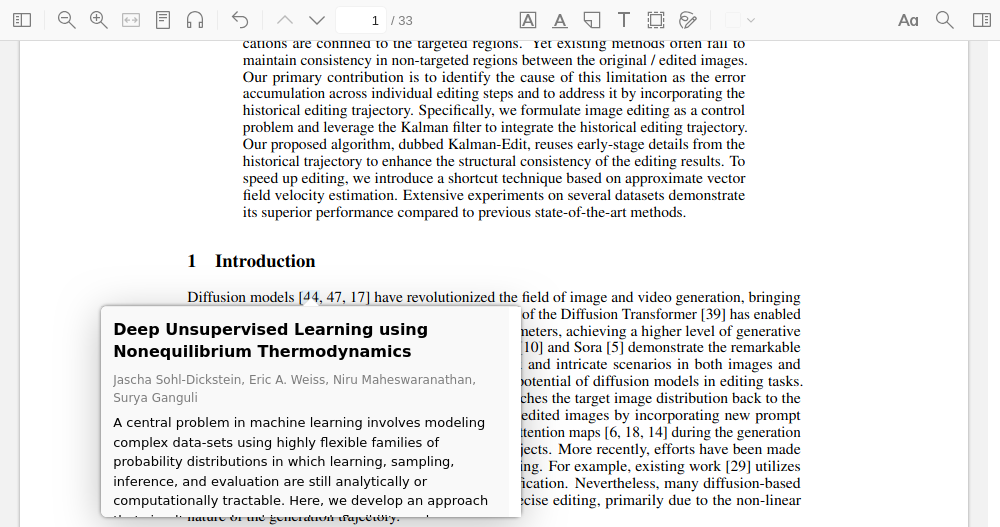

# Citation Preview for Zotero 10

Shows verified paper metadata and abstracts inside Zotero's native citation popovers. Hover over a supported citation to read the abstract; grouped citations have numbered buttons for selecting each paper. Moving away closes the native popup. Abstracts come from metadata services and are never generated.

Actual Citation Preview 0.2.0 running in Zotero 10.0.8 on Linux. The screenshot shows a public paper and an abstract retrieved from live metadata services. [Capture details and source](assets/README.md#screenshots).

For a first installation, download the XPI from [GitHub Releases](https://github.com/yulong-ge/zotero-citation-preview/releases/latest). In Zotero, open Add-ons → gear → Install Add-on From File. For an existing installation, use **Check for Updates** in the same menu. Disable or remove the addon to undo installation; no restart is required.

The plugin uses private Zotero reader interfaces. Some PDFs cannot be resolved, and correctly identified papers may lack a matching metadata record. See [behavior, privacy and limits](docs/reference.md).

For development, start with [the documentation guide](docs/README.md) and [setup and checks](docs/development.md). Automated GUI tests run in an isolated Zotero profile; they do not control your personal reader. Bug reports and fixes are tracked with [Issues](https://github.com/yulong-ge/zotero-citation-preview/issues) and PRs.
